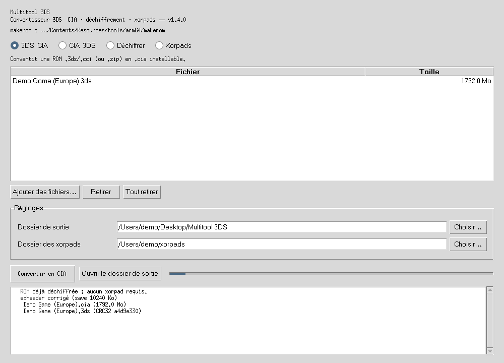

# Multitool 3DS — macOS

**Français** : [README.fr.md](README.fr.md)

**Convert 3DS ROMs to CIA — and back — on a Mac, in one window, with nothing to install.**

## ⬇ Download

**[Multitool-3DS-macOS.zip](https://github.com/jeromepepermans/3ds-cia-converter-macos/releases/latest/download/Multitool-3DS-macOS.zip)**
— universal `.app` for Apple Silicon and Intel (~43 MB, Python and `makerom` bundled).

All releases: **[github.com/jeromepepermans/3ds-cia-converter-macos/releases](https://github.com/jeromepepermans/3ds-cia-converter-macos/releases)**

macOS port of *Multitool 3DS* by TheRinzler65: **.3ds ↔ .cia** conversion, ROM decryption and
**xorpad** generation. A single application with nothing to install — no Python, no Homebrew, no
third-party tool to download.



## Why this one

| Tool | Type | What it does |
|---|---|---|
| [ihaveamac/3dsconv](https://github.com/ihaveamac/3dsconv) (643★) | CLI, Python | 3DS → CIA |
| [knktc/CiaForge](https://github.com/knktc/CiaForge) (5★) | desktop, Rust | CCI → CIA |
| [vanshksingh/Smelt-3DS-Decryptor](https://github.com/vanshksingh/Smelt-3DS-Decryptor) (26★) | macOS app, SwiftUI | decrypts .3ds/.cia/.cci |
| **this app** | macOS `.app`, no install | **3DS → CIA, CIA → 3DS, decrypt, xorpads** |

Stars as of 2026-11-08. The difference that matters: conversion works **with an exheader xorpad,
without needing boot9 keys**, and the same window does the reverse conversion and the decryption.

> Status: the 3DS → CIA conversion was validated on a real macOS machine (2026-11-08, see
> *Known limitations*). GPL-2.0, derivative work of
> [TheRinzler65/Convertisseur-3DS-CIA](https://github.com/TheRinzler65/Convertisseur-3DS-CIA).
> Not affiliated with Nintendo; no keys and no ROMs are provided.

## 1. Install

1. Unzip `Multitool-3DS-macOS.zip`.
2. Drag **Multitool 3DS.app** into **Applications**.
3. First launch: **right-click → Open** (the app is not signed by an Apple-identified developer).

If macOS refuses with “application is damaged”, run this once in Terminal:

```bash
xattr -dr com.apple.quarantine "/Applications/Multitool 3DS.app"
```

> The bundle ships two copies of the Python runtime: **Apple Silicon** (`arm64`) and **Intel**
> (`x86_64`). The launcher picks the right one automatically — nothing to decide.

## 2. Usage

Four modes, in the top bar.

### 3DS → CIA

1. Add a `.3ds`, `.cci`, or a `.zip` containing `.3ds` files.
2. Check the **output folder**.
3. Click **Convertir en CIA**.

The `.cia` is written to the output folder. Possible cases:

- **Already decrypted ROM** (`NoCrypto` flag): direct conversion.
- **Encrypted ROM**: the exheader **xorpad** is required. If it is missing, the app stops and
  says so, pointing to the **Xorpads** tab.
- An **invalid** xorpad is rejected: the exheader hash does not match, so the ROM would come out
  corrupted.

### CIA → 3DS

Add the `.cia` files, click **Convertir en 3DS**. The app first reads the CIA header, ticket and
TMD, then calls `makerom` with **production keys** (`-target p`): this is required for retail
CIAs, whose titlekey is encrypted with the retail common key (makerom's default — “test” — fails
with exit code 253).

The resulting ROM keeps its original NCCH encryption: for an emulator, chain with **Déchiffrer**
(which accepts a `.cia` directly and performs the intermediate conversion).

### Decrypt

Requires a key file, in this order of preference:

1. `boot9.bin` (console dump, 32 or 64 KB) — placed at `~/3ds-keys/boot9.bin` or selected with the
   **Clés** field;
2. a text file containing at least `slot0x2CKeyX=…` (plus `slot0x25KeyX=…` for post-7.0 games).

**Obtaining `boot9.bin`** (the exact path, often misreported):

1. GodMode9 on the console → **`[1:] MEMORY VIRTUAL`** drive
   (**not** `SYSNAND VIRTUAL`, where this file does not exist);
2. `boot9.bin` → **A** → *Copy to 0:/gm9/out*;
3. mount the SD card on the Mac and click **Importer les clés depuis la carte SD…**: the app looks
   for `gm9/out/boot9.bin`, validates it (32/64 KB) and copies it to `~/3ds-keys/`.

If `boot9.bin` does not appear in `MEMORY VIRTUAL`: GodMode9 is too old, or it lacks bootrom
access (update `GodMode9.firm`, launched under Luma3DS/boot9strap).

Decryption is **verified**: the decrypted exheader must hash back to its original SHA-256. With
wrong keys the app stops instead of producing a silently invalid ROM. Output:
`<name>-decrypted.3ds`.

### Xorpads

Add the relevant ROMs, click **Générer ncchinfo.bin**. Then, on the console:

1. copy `ncchinfo.bin` to the SD card root;
2. GodMode9 → `XORpad options` → `Generate ncchinfo xorpads` (or Decrypt9 → `ncchinfo padgen`);
3. copy the produced `.xorpad` files into the app's **xorpads** folder.

## 3. Settings

Paths (output, xorpads, keys) are remembered in
`~/Library/Application Support/Multitool 3DS/prefs.json`.

`makerom` (v0.19.0, Project_CTR) is **bundled** in the app, under
`Contents/Resources/tools/<arch>/`. If you have another copy, the app uses `MULTITOOL_MAKEROM`,
then `~/3ds-tools/makerom`, then `PATH`.

## 4. Command line (optional)

```bash
"/Applications/Multitool 3DS.app/Contents/Resources/runtime/arm64/bin/python3" \
  "/Applications/Multitool 3DS.app/Contents/Resources/app/launch.py"
```

Subcommands also exist from source (`to-cia`, `to-3ds`, `decrypt`, `ncchinfo`, `--keys`, `-o`,
`--xorpads`).

## 5. Known limitations

| Case | State |
|---|---|
| Encrypted retail `.3ds` without a xorpad | conversion refused (explicit message) |
| Encrypted eShop CIA (AES-CBC content, *titlekey*) | handled: `-target p` then NCCH decryption; **Déchiffrer** accepts a `.cia` directly |
| 9.6+ games with *seed* crypto (`flags[7] & 0x20`) | refused with an explicit message: no *seeddb* bundled |
| ROMs larger than 2 GB | supported (no 32-bit limit) |
| Signatures of produced CIAs | fake: install on a console running Luma3DS (signature patches) |
| Real-machine validation | 3DS → CIA conversion validated on macOS (2026-11-08); CIA → 3DS and decryption are validated offline only |

## 6. Development

```text
src/multitool3ds/    headers.py   NCSD/NCCH parsing
                     ncchinfo.py  ncchinfo.bin generation
                     crypto.py    keygen, AES-CTR (openssl + pure-Python fallback), keys
                     rom.py       extraction, xorpads, verified decryption
                     cia.py       CIA diagnosis (header/ticket/TMD)
                     converter.py pipelines
                     toolchain.py makerom
                     gui.py       Tkinter interface
tests/test_core.py   48 offline checks (no ROM required)
packaging/build_app.py  universal .app assembly
```

```bash
python3 tests/test_core.py          # expect 48/48
python3 packaging/build_app.py      # builds dist/Multitool 3DS.app
```

Each source file carries an SPDX `GPL-2.0-only` header.

## 7. Credits and licence

- Original code: **TheRinzler65**, `Convertisseur-3DS-CIA` (GPL-2.0), after `drizzt`, `mid-kid`,
  `3DSGuy` (`make_cia`) and `ArchShift`/`d0k3` (`ncchinfo_gen`).
- `makerom`: **3DSGuy**, *Project_CTR* — official macOS v0.19.0 binaries.
- Python runtime: **python-build-standalone** (astral-sh), Python 3.12.
- Crypto cross-check: formulas compared against **pyctr** (MIT).

This port is distributed under **GPL-2.0**, like the original work (see `LICENSE`).
The tool is not affiliated with Nintendo; it circumvents no protection and ships neither keys nor
ROMs.
